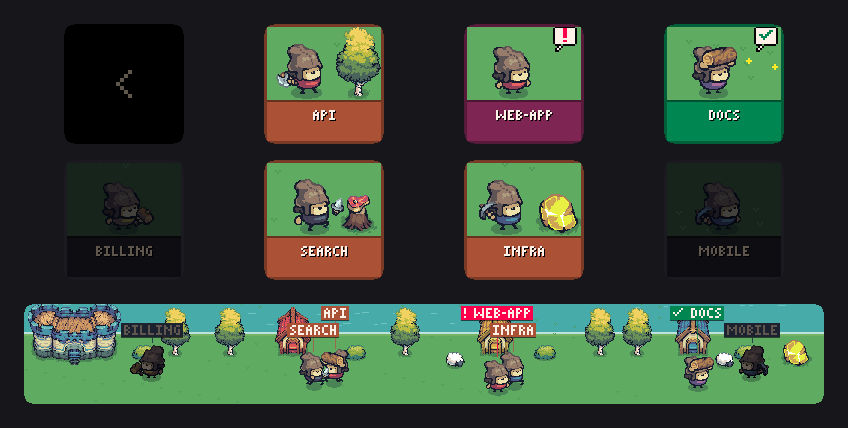
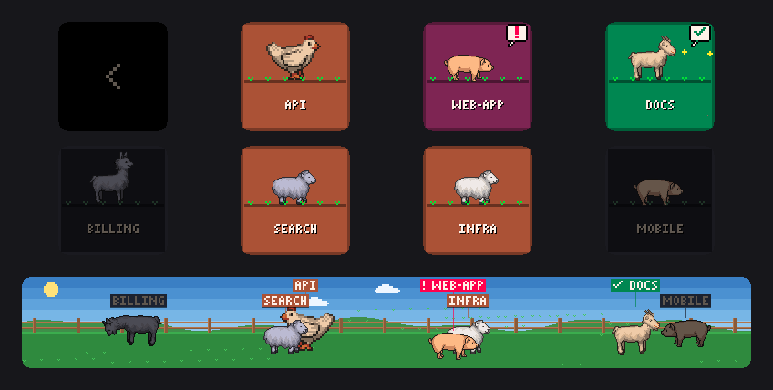

<h1 align="center">Corral</h1>

<p align="center">
  <b>Your coding agents as a herd of pixel-art critters on a Stream Deck +.</b><br>
  See who's working, who needs you and who's done at a glance. Tap one to jump straight to it.
</p>

<p align="center">
  
</p>

<p align="center">
  
  
  
  
</p>

---

Each agent from [herdr](https://herdr.dev) becomes a little character that keeps the same look for its workspace, so
you know who's who without reading. Every key is one agent. The touch strip shows the whole herd together, each critter
standing right under its key.

| | What you see |
|---|---|
| 🟤 **Working** | Busy: walking, chopping wood, mining, hammering |
| 🔴 **Needs you** | Hopping with a blinking **!** bubble, front and centre |
| 🟢 **Done** | Showing off its work with a **✓** and sparkles |
| ⚫ **Idle** | Dimmed and resting, so it stays out of the way |

Agents that need you come first, then finished ones, then working, then idle.

## Themes

Turn the last dial to switch. Your choice is remembered.

### Kingdom

Every workspace gets a pawn with a job (lumberjack, miner, builder or butcher) and a team colour. Working pawns haul
wood, gold and meat back to the castle, and the island changes with the time of day.


### Farm

Goats, sheep, cows, pigs, llamas and chickens grazing in a field, under a sky that follows your clock, with stars at
night.



### Ramen / Cocina

An included, original pixel-art kitchen: chefs carry steaming stockpots while working, open recipe books when
blocked, and serve finished ramen with a checkmark. Idle chefs put their utensils away; unknown states show `?`.
Aprons keep the agent's identity colour. No downloaded sprites or invented cooking-progress percentages.
See [Ramen theme](docs/ramen-theme.md).

### Invitado: your own mascot

Install a local two-frame, five-status PNG atlas and attribution JSON, restart Corral, and **INVITADO** joins the theme
cycle. The original MIT **Luma** example is included under `examples/mascot-packs/luma`; follow
[mascot pack installation and format](docs/mascot-packs.md). Packs are data only, live outside the plugin bundle,
and cannot execute code. Invalid or missing packs leave the built-in themes available.

Want to make one? See **[Adding a theme](docs/adding-a-theme.md)**. It's one file, and there's a working template to
start from.

## Controls

| | |
|---|---|
| **Tap a key** | On release, focus that agent in herdr and bring the terminal forward |
| **Hold a key for at least 500 ms, then release** | Pin/unpin that agent to that physical action key, without focusing |
| **Tap the touch strip** | Focus the critter you tapped |
| **Long-touch a character on the strip** | Pet it: one second of pixel hearts, without focusing or changing task state |
| **Push any dial** | Jump to the agent that needs you most |
| **Turn dials 1–3** | Page through agents when there are more than keys |
| **Turn dial 4** | Switch theme |

### Pinned agents

A yellow pixel pushpin and **PIN** mark a pinned key. Its agent stays there when another agent needs you, when
status/priority changes, and when you turn pages. Unpinned keys keep the usual urgency order; pinned agents are
excluded from those keys and from their page count, so the same pane never appears twice. The strip uses the same
resolved layout and its tap targets update immediately after a pin or page change.

If a pinned pane disappears, its key stays reserved with **PIN / MISSING** instead of silently showing another agent.
The strip leaves that position vacant. If the same pane ID returns it reclaims its key. Hold and release the reserved
key to free it; a short tap alerts without focusing anything. A tap captures the pane at press time, so a poll or page
change while you press cannot redirect it to a different agent. Missing panes and focus failures alert.

Pins are **session-only**, keyed by the Stream Deck action ID and herdr pane ID, not by roster position or workspace
name. Restarting the plugin clears them. Removing an action, switching away from its profile, or disconnecting its
device (the SDK action disappears) also releases its pin and cancels an unfinished press. No pin settings are written
to disk.

With every key pinned, paging has no free slots and does nothing; release a pin to browse other agents. With no agent
keys configured anywhere, the strip retains its first-eight-agent preview and paging is inert. Multiple devices share
one ordered key roster/page (device ID, then row and column); each device's strip shows only its own keys, with separate
animation and tap targets. A pane can be pinned once across that roster. Duplicate pane/action IDs are first-wins.
Multi-actions and keys without physical coordinates are excluded.

### Offscreen attention beacon

The rightmost strip segment shows a beacon when blocked agents are absent from that device's current keys,
including when every key is pinned. The count includes distinct hidden panes, and the displayed target stays stable
across priority reordering. Tap the beacon to focus exactly that still-blocked hidden agent without moving pins or
pages. If the target disappeared or became visible, the tap does not silently redirect to another agent.
Disconnected/held touches cannot focus; Showcase keeps the safe alias but disables opening.

### Petting

Long-touch a visible character to show three original pixel hearts for one second. Short touches retain their usual
focus behavior. Petting also works in Showcase, never changes an agent's state, and stays local to the touched device.
Effects expire without replaying and are cleared when a pane disappears or the theme changes. Passive cloud and
beacon overlays take precedence over characters underneath them.

### Optional Cursor Cloud Agent

Add the **Cursor Cloud Agent** key to monitor one existing remote agent. Provide `CURSOR_CLOUD_AGENT_ID` and
`CURSOR_API_KEY` to the plugin's launch environment; see [configuration and current API contract](apps/plugin/CURSOR-CLOUD.md).
The key and a passive cloud in the left strip segment follow the latest run independently of local herdr, with
read-only polling and backoff. Releasing the dedicated key revalidates and opens only that configured Cursor page.
Showcase hides the cloud name and blocks opening. Disconnects show **UNKNOWN**, never a retained success.
No tasks are created, cancelled or approved. Authenticated API access and physical hardware need separate verification.

## Showcase / Vidriera (camera mode)

Drag the optional **Showcase / Vidriera** action from the Corral category onto a spare key. Press it before filming.
Its camera icon says **CAMERA ON**, and every agent key and touch-strip segment shows a yellow camera / **SHOWCASE**
badge. Press the same key again to resume normal labels and controls. The toggle key does not count as an agent slot.

While enabled:

- Workspace, title and subtitle captions become **AGENT A**, **AGENT B**, **AGENT C**, etc. (after Z: AA, AB, …).
  Aliases are assigned by `paneId`, not priority or key position. Paging, reordered agents, temporary disappearance,
  status updates and toggling off/on do not rename an existing pane. New panes receive the next unused alias.
- Both Farm and Kingdom keep their original appearance seeds, species/coats, jobs/team colours, focused borders and
  live status animations. Polling continues against your current herdr session; this is **not** a pretend session.
- Key holds still pin/unpin agents without focusing, and pins keep their safe aliases and **PIN** badges.
- Agent keys, touch taps and dial pushes cannot focus agents or bring the terminal forward. Dial rotation still pages
  and switches themes. The toggle itself never focuses. For **one second after toggling**, focus events are ignored to
  absorb queued/trailing gestures; press deliberately again after that interval to focus.
- A focus request already waiting for herdr is permanently invalidated by a toggle, so its completion cannot later
  bring the terminal forward. A command already sent to herdr cannot be undone.
- Error captions are fixed public messages (`herdr off` / `HERDR IS DOWN`), never exception text or private labels.

Mode and aliases are **process-session local**, not persisted to global settings. Restarting the plugin resets aliases
and starts with camera mode **off**; check **CAMERA ON** before each recording. Removing/re-adding the toggle or agent
actions does not reset aliases while the plugin process is still running.

This protects **Corral's built-in on-device captions and focus gestures**, not your desktop, terminal contents, logs,
Stream Deck configuration UI, external tools or third-party themes that draw identity seeds as text. Canonical agents
remain private, unmodified data internally; the renderer receives a separate presentation projection. Choose a capture
region that excludes those other surfaces. Demo mode below is separate: it creates pretend agents and still allows focus.

### Showcase tests (no hardware)

```sh
bun install --frozen-lockfile
bun run test:plugin
bun run --cwd apps/plugin typecheck
bun run build:plugin
```

The plugin test script uses Bun file isolation so the pins and Showcase SDK/CLI fixtures cannot share cached modules.
Type-checking includes the tests as well as the plugin and scripts.

Tests exercise the real action handlers, state, herdr subprocess adapter and pixel renderers. Only the unavailable
Stream Deck SDK connection is mocked. A local fake herdr executable supplies synthetic private captions and records
focus calls. Farm uses the shipped artwork. Kingdom uses **original procedural test sheets** in the scratch directory,
not the unredistributable Tiny Swords assets; the real Kingdom drawing code still runs. Physical hardware delivery and
macOS terminal activation require a separate device smoke test.

## Install

You need:

- a Stream Deck + and the Stream Deck app, on macOS;
- [herdr](https://herdr.dev);
- [Ghostty](https://ghostty.org);
- [Bun 1.4.3](https://bun.sh).

Then build the plugin and register it with the Stream Deck app:

```sh
git clone https://github.com/fedeya/corral
cd corral
bun install
bun run build:plugin
bun run link
```

In the Stream Deck app, open the **Corral** category. Drag **Agent slot** onto every key you want to use, and
**Agents strip** onto all four dials.

> [!NOTE]
> The herdr path (`/opt/homebrew/bin/herdr`) and the terminal (Ghostty) are hard-coded in `apps/plugin/src/herdr.ts` for now.

### Enabling the kingdom theme

The kingdom art can't be redistributed, so it isn't in the repo:

1. Download [Tiny Swords](https://pixelfrog-assets.itch.io/tiny-swords) by Pixel Frog. It's free.
2. Copy the sprites into `apps/plugin/dev.fedeya.corral.sdPlugin/imgs/kingdom/`: pawns for each team colour, trees, castle, houses,
   gold stone, bushes, sheep, stump, meat and wood. The exact file names are in `apps/plugin/src/themes/kingdom.ts`.

The theme appears as soon as the files are there.

## Website

The Desk landing page lives in `apps/web`. From the repository root, run `bun run dev` to start it locally
or `bun run build:web` to produce the static site in `apps/web/dist/`.

The website includes `public/favicon.svg` and a 1200×630 `public/og.png`. Set `CORRAL_SITE_URL` to the
public deployment URL when building so the Open Graph and Twitter image tags contain an absolute URL
(for example, `CORRAL_SITE_URL=https://your-domain.example/ bun run build:web`). Without it, local previews
use `/og.png`; no production domain is assumed. The browser scene and agent conversations are simulated.

## Development

This Bun monorepo contains `@corral/plugin` in `apps/plugin` and the website in `apps/web`. Install dependencies
once with `bun install` at the repository root. All commands below run from that root; plugin wrappers set the
plugin working directory and forward arguments.

| Command | |
|---|---|
| `bun run build` | Build both workspaces |
| `bun run build:plugin` | Bundle the Stream Deck plugin |
| `bun run build:web` | Build the website |
| `bun run watch` | Rebuild the plugin on changes |
| `bun run restart` | Reload it in the Stream Deck app (needs `streamdeck dev`) |
| `bun run preview <theme> --open` | Render keys and touch strip to a PNG, no device needed |
| `bun run media` | Re-render the GIFs in `docs/media/` |
| `bun run demo on` / `off` | Pretend agents in a separate herdr session, for recordings (see below) |
| `bun run typecheck` | Type-check both workspaces |
| `bun run test` | Run both workspace suites (not root test autodiscovery) |
| `bun run test:plugin` | Run isolated layout, gesture, real-render and SDK action-path tests |
| `bun run test:web` | Run website tests |
| `bun run validate` | Validate the Stream Deck plugin |

The plugin polls `herdr agent list` every second and focuses agents with `herdr agent focus`. Logs go to
`apps/plugin/dev.fedeya.corral.sdPlugin/logs/`.

Tests exercise real layout, gestures, PNG rendering and herdr subprocess calls. Only the Stream Deck SDK dispatch /
device transport is mocked; a test-only herdr CLI fixture supplies synthetic panes. Tests do not prove physical
hardware timing or terminal activation (macOS `open -a` is not available in Linux CI). Runtime fixture files are
created under `TMPDIR` and removed on completion.

### Demo mode

`bun run demo on` starts a separate herdr session, `corral-demo`, with pretend agents that look like a coding agent at
work. They follow a script (`apps/plugin/scripts/demo-story.ts`): they start working, some finish, some stop and ask you to confirm
(press `1`). The plugin switches to that session, so tapping a key opens the pretend agent. Your real herdr session isn't
touched.

Open the demo in Ghostty with `herdr --session corral-demo`. Run `bun run demo on` again to restart the story, and
`bun run demo off` when you're done.

## Credits

- **Farm:** [LPC farm animals](https://opengameart.org/content/lpc-style-farm-animals) by Daniel Eddeland and
  [LPC Goat](https://opengameart.org/content/lpc-goat) by bluecarrot16, CC-BY 3.0.
- **Kingdom:** [Tiny Swords](https://pixelfrog-assets.itch.io/tiny-swords) by Pixel Frog. Not included in the repo.
- **Code:** [MIT](LICENSE).
